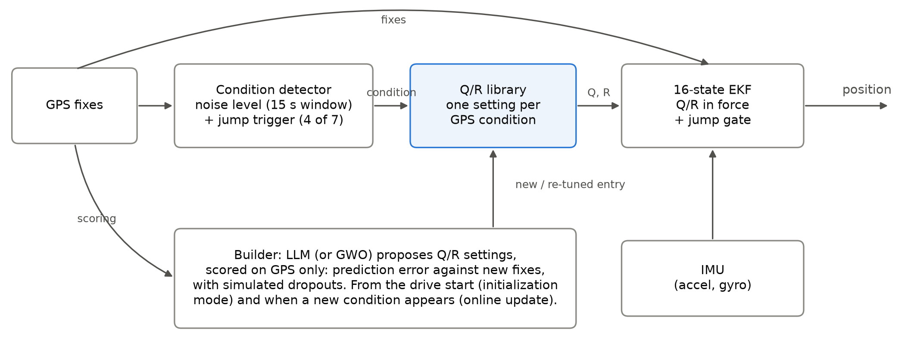
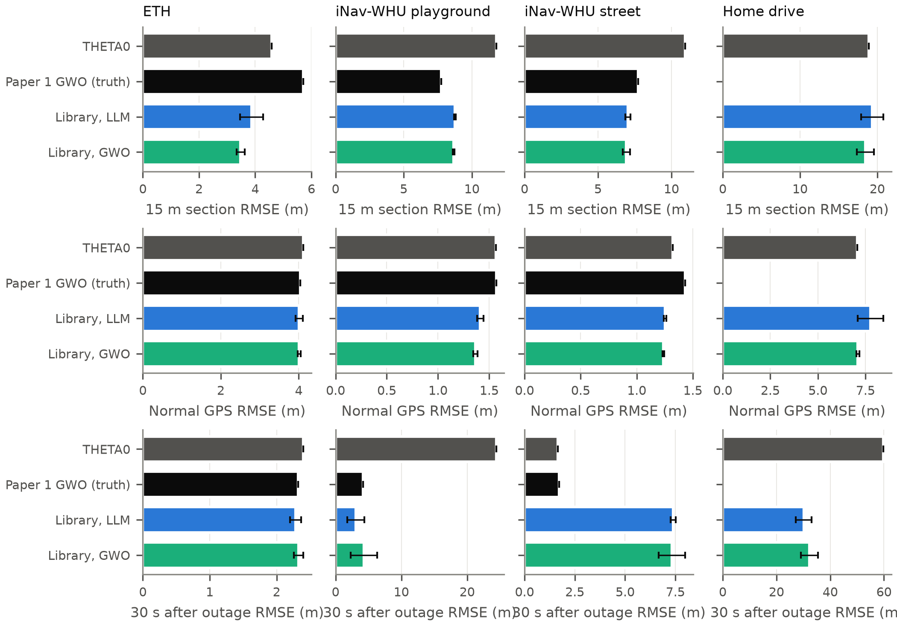
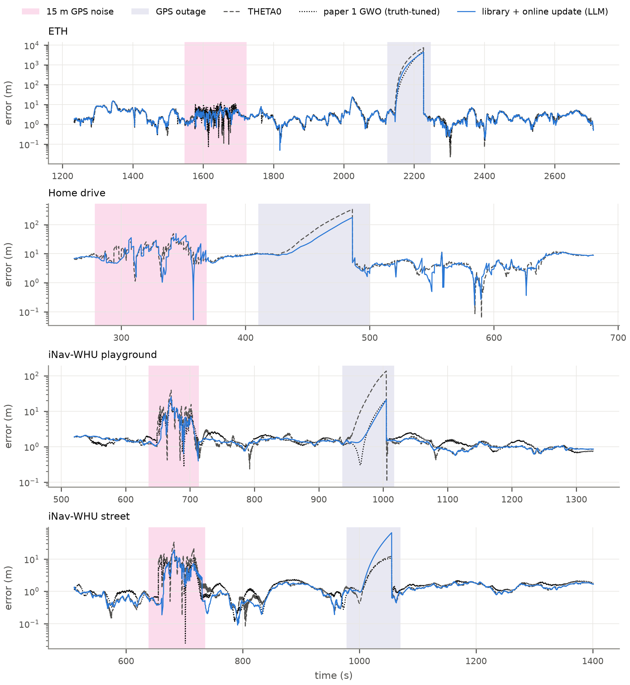
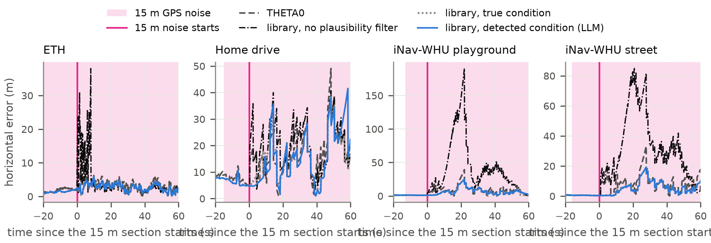
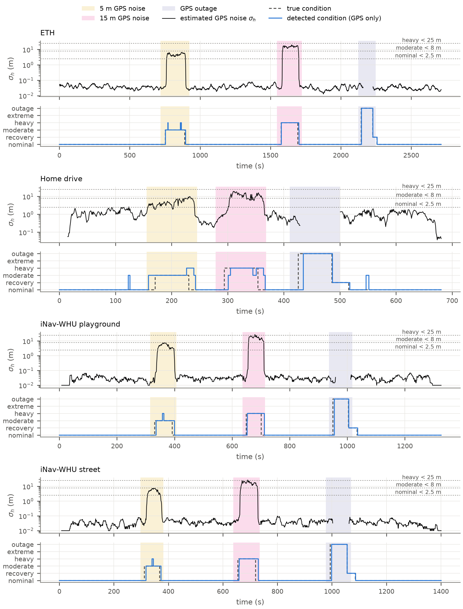
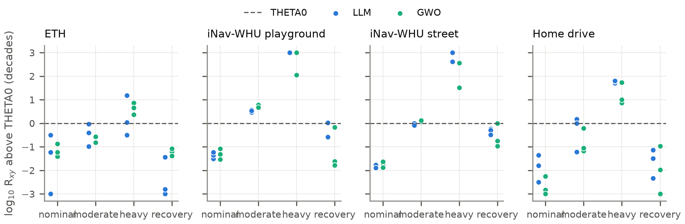
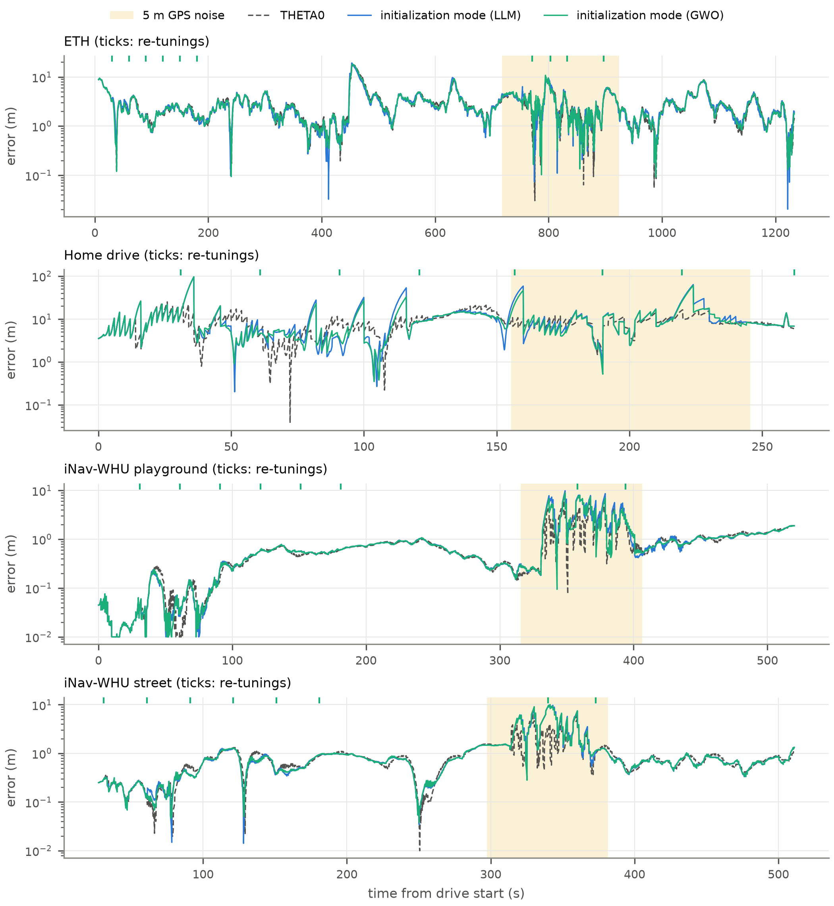

# Condition-Aware Transformer-Based Q/R Tuning Library for GPS-IMU Kalman Filters

A GPS-IMU Extended Kalman Filter is only as good as its noise covariances, and the right covariances depend
on the GPS: what suits clean fixes fails under heavy noise and the other way round. One offline-tuned setting
has to compromise across every condition a vehicle drives through, and tuning it needs ground truth.

This repository is the code for a filter that tunes itself while it drives. It keeps a **library of Q/R
settings, one per GPS condition** (normal, moderate noise, heavy noise, recovery after an outage), recognises
the current condition from the GPS fixes alone, and switches between entries online. A **pretrained
transformer language model** proposes the settings, and each proposal is judged by a **GPS-only score**, so
neither building nor switching ever sees ground truth. The library is built causally from the start of the
drive (initialization mode) and extended whenever an unseen condition appears (online update). The benchmark
is the untuned starting setting THETA0 and the Grey Wolf Optimizer, the strongest optimizer in our earlier
study [1], as the matched-budget builder without language.

## Relation to the preprint

This work builds on our preprint *Joint Tuning of Q and R in a GPS-IMU EKF* [1], which tuned Q and R jointly
and offline for the same 16-state filter, on the same three drives, with GA, PSO, DE and GWO against
ground truth, and found GWO the strongest of the four. That setting leaves three questions open, which this
paper answers:

| Preprint [1] | This paper |
|---|---|
| One Q/R for the whole drive | One Q/R per GPS condition, switched online |
| Tuned against ground truth | Tuned on GPS alone (self-supervised score) |
| Offline, on the complete recording | Causal: built while driving, from the drive start |
| Metaheuristic optimizers | A transformer language model as the optimizer, against GWO |

Reused from [1]: the EKF (`ekf/`: filterpy reference and batched GPU filter, the per-drive starting values
`THETA0`, data loading), the three drives with their degraded GPS sections (`processed_data/`), GWO, and
[1]'s ground-truth-tuned GWO settings, which serve as a reference row in every table.

## Contributions

1. **A condition-aware Q/R library** for a GPS-IMU EKF, with a GPS-only condition detector and a
   plausibility filter that keeps the switch from corrupting the filter state at the onset of noise.
2. **A self-supervised score** for Q/R settings: prediction error against incoming GPS fixes, with simulated
   GPS dropouts so that it also measures coasting on the IMU.
3. **Causal construction**: an initialization mode that builds the library from the drive start and an online
   update for unseen conditions. No offline phase and no ground truth.
4. **A transformer language model as the Q/R optimizer**, compared at equal evaluation budget with the
   preprint's GWO, with three seeds, ablations of every component, and the preprint's
   ground-truth-tuned settings as a reference.

## Method



**Filter and parameters.** The 16-state EKF of [1] (position, velocity, attitude quaternion, accelerometer
and gyroscope biases), with a Joseph-form GPS update and a displacement plausibility gate (a fix is used only
if it lies within 6 m/s x dt + 25 m of the last accepted fix). A Q/R setting is seven log10 values:
accelerometer and gyroscope white-noise PSDs, their bias random walks, and the GPS horizontal, vertical and
velocity variances. R, which models the GPS, is searched over THETA0 +- 3 decades; Q, which models the IMU and
does not change with the GPS, over +- 1 decade (see the coasting check below). The batched filter
(`qrlib/aekf.py`) runs many settings at once and matches the filterpy reference to 1.4e-14 m.

**GPS condition detector** (`qrlib/data.py`). Every second, from the fixes received so far: *outage* (no fix
for max(2 s, 5 intervals)), *recovery* (the first 30 s after an outage), otherwise a noise level sigma_h,
a robust (MAD) estimate of the fixes' white noise over the last 15 s, binned as *nominal* (< 2.5 m),
*moderate* (< 8 m), *heavy* (< 25 m) or *extreme*, with 20 % hysteresis at the bin edges. A cleaner condition
must hold for 2 s before the library switches back.

**Plausibility filter.** A setting that trusts clean GPS would fuse the first fixes of a noise onset before
any window-based detector can react, and the state errors they cause outlast the switch. Each fix's *jump*,
its distance from the straight line through the two fixes before it (GPS only, known on arrival), drives two
rules:
- *Jump gate*: under nominal or moderate GPS, a fix that jumps more than the condition's bin edge is not
  fused. Heavy and extreme conditions are not gated; their settings already weight GPS lightly.
- *Jump trigger*: when at least 4 of the last 7 fixes jump beyond a noisier bin's edge, the library switches
  to that bin at once (up to heavy; extreme is left to the 15 s window).

**Library lookup.** The entry for the detected condition is used. A noise condition without an entry takes the
nearest cleaner entry with its R raised to at least THETA0's and its horizontal and vertical GPS variance to at
least the lower edge of its own noise bin (heavy: 8 m), so an unseen, noisier condition never trusts GPS more
than a cleaner one, the default, or the noise level the detector has measured; otherwise the nearest noisier
entry.

**GPS-only score** (`qrlib/runner.py`). A candidate is run on the condition's 30 s windows, starting from the
running filter's state, and scored by the RMS of |GPS fix - predicted position| over the windows' fixes. For
white GPS noise, E|z - p_pred|^2 = E|p - p_pred|^2 + sigma^2, so the score ranks candidates as their true
prediction error would. One-step predictions say little about Q, which mainly governs how the filter coasts
without GPS, so in every window the fixes from 5 to 10 s into each 15 s are hidden and the first fix after
each gap measures the coasting error.

**Builders** (`qrlib/propose.py`, `qrlib/build.py`). Each proposes 8 settings per round, seeded with THETA0
and the library's existing entries:
- *LLM*: Qwen3.5-9B (Q4_K_M, llama.cpp server, hidden reasoning off, temperature 0.8) in an OPRO-style
  prompt: the filter, each parameter's meaning, units and bounds, the detected condition and its sigma_h, the
  entries for other conditions and the scored history; it reasons briefly and replies in JSON (an unusable
  reply is filled near the best setting and counted).
- *GWO*: the preprint's Grey Wolf Optimizer (alpha, beta, delta leaders; a from 2 to 0 over the rounds),
  with a pack of 8 started from the scored seeds plus uniform random wolves.

**Initialization mode** (drive start to the end of the training part). The filter starts on THETA0 and follows
the library as it grows. Each time a condition completes a new 30 s window (up to its first 6), its entry is
re-tuned on its windows so far (2 rounds of 8), from the running filter's own states, and used from then on.

**Operation mode.** The library switches with the detected condition. A noise condition without an entry that
lasts 40 s gets one (a recovery: 20 s, its GPS is clean): 3 rounds of 8 on that window, scored from the filter's
state at the window start. Only R is searched; tens of noisy fixes cannot judge the IMU's noise, so Q stays at
the setting in force. Once the entry is found, the filter re-processes the window with it from that same state
(causal fixed-lag re-filtering; the positions already output are kept), so the entry is used from the state it
was scored from rather than from one the window's noisy fixes have already corrupted. Outages have no fixes to
score and get no entry.

## Experimental protocol

**Data.** The three drives of [1], each with three degraded GPS sections at 25, 50 and 75 % of the path: about
5 m of added white noise, about 15 m, and a complete outage. ETH Zurich (10 Hz IMU, 5 Hz GPS with velocity)
and iNav-WHU playground00 and street00 (200 Hz ADIS IMU, 1 Hz GPS, position only). A fourth drive was
collected for this paper: a car in Delhi (11 min, 7.7 km, up to 24 m/s) with an MPU-6500 IMU at 100 Hz and
an NMEA GNSS module at 0.5 Hz, position only (`python make_home_data.py` turns `collected data/` into
`processed_data/home/`). Its reference track is a consumer GNSS log, not RTK (7.3 m RMS from the module), so
errors against it include the reference's own error. At car speed 76.2 m of travel lasts ~5 s, so its three
sections last 60 s each (as long as iNav-WHU's), and the drive starts at its first stop (static start).

**Split.** Each drive is one continuous run, split midway between the 5 m and the 15 m section. The first part
(normal GPS and the 5 m section) is the initialization period; the second part (normal GPS, the 15 m section
and the outage), which the library has never seen, is the test.

**Methods on the test part.** Raw GPS; THETA0; the preprint's ground-truth-tuned GWO setting [1] (a
reference: tuned offline on the whole drive with truth); and for each builder: a static setting (one setting
tuned on the whole initialization period, the usual approach) and the library with online update.

**Ablations.** Within every run: without the online update, without the plausibility filter, and with the true
condition in place of the detector (its upper bound). As separate runs (LLM, seed 0): the library built
offline after the initialization period, the one-step score without dropouts, and Q searched over +- 3
decades.

**Metrics.** Horizontal RMSE in the 15 m section, on normal GPS, in the 30 s after the outage, and during the
outage (reported separately: no Q/R setting stops IMU drift without fixes); NIS/dof; the error during the
initialization period against THETA0; detector agreement and onset delay; LLM calls, tokens and time.
Three seeds per builder (each seed re-runs every search, LLM sampling included); mean +- std.

## Validation of the design

Ground truth is used here only to check design choices, never to build or switch.

**Detector.** It agrees with the true condition 97-99 % of the time and recognises a noise section 1-2 s after
it starts on ETH (5 Hz GPS) and 4-7 s on iNav-WHU (1 Hz), against 10-14 s for the 15 s window alone.

**Switching.** With fixed per-section settings in the library (THETA0 for normal GPS, the best 5 m and 15 m R
from an R grid scored on GPS only), horizontal RMSE in the 15 m section:

| Drive | THETA0 | Library, no plausibility filter | Library, detected condition | Library, true condition | 15 m setting from the section start |
|---|---:|---:|---:|---:|---:|
| ETH | 4.58 | 3.63 | 3.49 | 3.54 | 3.49 |
| iNav playground | 11.78 | 32.56 | 6.21 | 6.19 | 6.19 |
| iNav street | 10.93 | 7.59 | 6.44 | 6.44 | 6.45 |

With the plausibility filter, switching on the detected condition matches switching on the true condition and
applying the 15 m setting exactly from the section start.

## Reproducing

```powershell
# 1. the LLM, in its own terminal (an 8 GB GPU is enough)
cd D:\llama-b9754-bin-win-cuda-13.3-x64; .\llama-server.exe -m "D:\Modelfile\Qwen_Qwen3.5-9B-Q4_K_M.gguf" --alias qwen35-9b -c 4096 --port 8070
# 2. in another terminal, from this folder
pip install -r requirements.txt
python main.py                 # everything: 3 seeds x 4 drives, ablations, tables and figures (~8.5 h)
python main.py --plan          # what is done, what is left, rough time; runs nothing
python main.py --plots-only    # rebuild the tables and figures
python main.py --smoke         # a few-minute pipeline check (ETH and the home drive, GWO, no LLM)
python reset.py                # delete the results (lists them, then asks; --smoke, --all, --yes)
```

`main.py` runs each step in its own process and resumes after an interruption (a finished seed and drive is
skipped); a failed step is logged and the remaining steps still run; an LLM call that fails is retried and
then counted as an empty reply. Log: `results/qrlib/main.log`; sessions: `results/qrlib/main_manifest.json`.
The steps, also usable on their own:

```bash
python make_home_data.py                             # collected data/ -> processed_data/home/ (once)
python -m qrlib --seeds 0 1 2                        # main run -> results/qrlib/seed_<s>/<drive>/
python -m qrlib --seeds 0 --builders llm --offline   # ablation -> results/qrlib_offline/
python -m qrlib --seeds 0 --builders llm --onestep   # ablation -> results/qrlib_onestep/
python -m qrlib --seeds 0 --builders llm --wide-q    # ablation -> results/qrlib_wideq/
python -m qrlib.report                               # tables and figures -> results/qrlib/paper/
```

**Outputs** (`results/qrlib/paper/`): tables (main, ablations, initialization period, LLM cost, detector) as
Markdown and LaTeX, mean +- std over seeds; figures as PNG and PDF, with `captions.md`:

| Figure | Shows |
|---|---|
| fig1_pipeline | The system |
| fig2_detector | Estimated GPS noise and detected condition against the true sections |
| fig3_onset | Error at the onset of the 15 m section, with and without the plausibility filter |
| fig4_test_error | Error over the test part: THETA0, the preprint's GWO setting, the library |
| fig6_library | The library's horizontal GPS variance per condition, per builder and seed |
| fig7_initialization | Error during the initialization period against THETA0, with the re-tunings |
| fig8_headline | RMSE per drive and method, mean and std over seeds |

GPS sections are shaded 50 % wider than they are (centred) so that they remain visible at the scale of a
whole drive. Builders keep one colour throughout (LLM blue, GWO aqua; colour-vision
checked); references are drawn in neutral inks with their own dash patterns.

## Repository layout

| Path | Holds |
|---|---|
| `main.py` | The whole experiment in one resumable command |
| `reset.py` | Deletes generated results |
| `qrlib/config.py` | Every setting, with the reason for its value |
| `qrlib/aekf.py` | The batched EKF: per-decision Q/R, per-element start, displacement and jump gates, simulated dropouts |
| `qrlib/data.py` | Drives, split, condition detector, jump trigger and gate limits |
| `qrlib/runner.py` | Checkpoints, the GPS-only score, the switching policy, library lookup |
| `qrlib/propose.py` | Builders: LLM and GWO (random search and DE still selectable with `--builders`) |
| `qrlib/llm.py` | The llama-server client |
| `qrlib/build.py` | Initialization mode, offline build (ablation), static entry, the search loop |
| `qrlib/evaluate.py` | One drive end to end: every method, metrics, traces |
| `qrlib/score_check.py` | The score against ground truth (standalone; not part of `main.py`) |
| `qrlib/report.py` | Tables and figures |
| `make_home_data.py` | The home drive: `collected data/` -> `processed_data/home/` |
| `ekf/` | The preprint's EKF; the plausibility rule's top speed can now be set per drive (`max_speed_ms`) |
| `processed_data/` | The four drives with their degraded GPS sections |
| `research/research_map.md` | Literature map and research gaps |

## Results

Filled in by `python main.py` (its report step writes this section and `docs/figures/`):

<!-- RESULTS:START -->
Seeds 0, 1, 2. Horizontal RMSE in metres on the test part (normal GPS, the unseen 15 m section, the outage), mean ± std over seeds.

**Raw GPS against our system** (winner in bold):

| Drive               | Metric (horizontal RMSE, m)   | Raw GPS   | Our system (LLM)     | Winner                                 |
|:--------------------|:------------------------------|:----------|:---------------------|:---------------------------------------|
| ETH                 | 15 m section                  | 15.17     | **3.87 ± 0.42**      | Our system (74 % lower)                |
| ETH                 | Normal GPS                    | **3.93**  | 4.01 ± 0.09          | Raw GPS (2 % lower)                    |
| ETH                 | 30 s after outage             | **2.23**  | 2.29 ± 0.08          | Raw GPS (3 % lower)                    |
| ETH                 | Outage                        | no fixes  | **2032.34 ± 166.36** | Our system (raw GPS gives no position) |
| iNav-WHU playground | 15 m section                  | 17.19     | **8.75 ± 0.07**      | Our system (49 % lower)                |
| iNav-WHU playground | Normal GPS                    | **1.32**  | 1.41 ± 0.03          | Raw GPS (7 % lower)                    |
| iNav-WHU playground | 30 s after outage             | **1.49**  | 3.06 ± 1.30          | Raw GPS (51 % lower)                   |
| iNav-WHU playground | Outage                        | no fixes  | **5.35 ± 3.47**      | Our system (raw GPS gives no position) |
| iNav-WHU street     | 15 m section                  | 16.91     | **7.04 ± 0.17**      | Our system (58 % lower)                |
| iNav-WHU street     | Normal GPS                    | **1.20**  | 1.25 ± 0.01          | Raw GPS (4 % lower)                    |
| iNav-WHU street     | 30 s after outage             | **0.87**  | 7.40 ± 0.13          | Raw GPS (88 % lower)                   |
| iNav-WHU street     | Outage                        | no fixes  | **25.39 ± 0.42**     | Our system (raw GPS gives no position) |
| Home drive          | 15 m section                  | **17.96** | 19.35 ± 1.44         | Raw GPS (7 % lower)                    |
| Home drive          | Normal GPS                    | **6.53**  | 7.77 ± 0.67          | Raw GPS (16 % lower)                   |
| Home drive          | 30 s after outage             | **3.73**  | 30.13 ± 2.88         | Raw GPS (88 % lower)                   |
| Home drive          | Outage                        | no fixes  | **66.26 ± 6.03**     | Our system (raw GPS gives no position) |

**All methods:**

| Drive               | Method                              | 15 m section   | Normal GPS   | 30 s after outage   | Outage           | NIS / dof     |
|:--------------------|:------------------------------------|:---------------|:-------------|:--------------------|:-----------------|:--------------|
| ETH                 | Raw GPS                             | 15.17          | 3.93         | 2.23                | –                | –             |
| ETH                 | Baseline THETA0                     | 4.58           | 4.12         | 2.40                | 3493.03          | 0.54          |
| ETH                 | Paper 1 GWO (ground truth, offline) | 5.72           | 4.04         | 2.32                | 2100.28          | 1.15          |
| ETH                 | Static (llm)                        | 4.88 ± 1.38    | 4.12 ± 0.10  | 2.45 ± 0.14         | 2067.00 ± 150.42 | 3.15 ± 1.46   |
| ETH                 | Library (llm)                       | 3.87 ± 0.42    | 4.01 ± 0.09  | 2.29 ± 0.08         | 2032.34 ± 166.36 | 1.00 ± 0.40   |
| ETH                 | Static (gwo)                        | 3.73 ± 0.41    | 4.27 ± 0.11  | 2.62 ± 0.13         | 2005.30 ± 263.36 | 5.90 ± 8.65   |
| ETH                 | Library (gwo)                       | 3.48 ± 0.14    | 4.01 ± 0.04  | 2.33 ± 0.07         | 1706.74 ± 262.81 | 0.59 ± 0.06   |
| Home drive          | Raw GPS                             | 17.96          | 6.53         | 3.73                | –                | –             |
| Home drive          | Baseline THETA0                     | 18.90          | 7.06         | 59.77               | 135.42           | 1.64          |
| Home drive          | Static (llm)                        | 22.41 ± 1.04   | 6.92 ± 0.06  | 147.25 ± 83.72      | 357.75 ± 207.99  | 47.62 ± 60.70 |
| Home drive          | Library (llm)                       | 19.35 ± 1.44   | 7.77 ± 0.67  | 30.13 ± 2.88        | 66.26 ± 6.03     | 1.06 ± 0.41   |
| Home drive          | Static (gwo)                        | 23.33 ± 1.39   | 6.94 ± 0.20  | 151.25 ± 48.71      | 362.88 ± 131.91  | 56.97 ± 53.58 |
| Home drive          | Library (gwo)                       | 18.45 ± 1.12   | 7.10 ± 0.09  | 32.24 ± 3.22        | 66.71 ± 11.77    | 1.88 ± 0.14   |
| iNav-WHU playground | Raw GPS                             | 17.19          | 1.32         | 1.49                | –                | –             |
| iNav-WHU playground | Baseline THETA0                     | 11.78          | 1.57         | 24.41               | 55.99            | 7.48          |
| iNav-WHU playground | Paper 1 GWO (ground truth, offline) | 7.76           | 1.57         | 4.18                | 8.27             | 1.32          |
| iNav-WHU playground | Static (llm)                        | 10.36 ± 0.90   | 1.55 ± 0.03  | 13.47 ± 5.64        | 30.34 ± 13.17    | 5.79 ± 3.03   |
| iNav-WHU playground | Library (llm)                       | 8.75 ± 0.07    | 1.41 ± 0.03  | 3.06 ± 1.30         | 5.35 ± 3.47      | 0.21          |
| iNav-WHU playground | Static (gwo)                        | 8.97 ± 0.04    | 1.52         | 11.53 ± 0.07        | 25.37 ± 0.15     | 5.06 ± 1.25   |
| iNav-WHU playground | Library (gwo)                       | 8.66 ± 0.07    | 1.36 ± 0.02  | 4.29 ± 2.01         | 8.37 ± 4.25      | 0.32 ± 0.17   |
| iNav-WHU street     | Raw GPS                             | 16.91          | 1.20         | 0.87                | –                | –             |
| iNav-WHU street     | Baseline THETA0                     | 10.93          | 1.32         | 1.65                | 6.92             | 5.38          |
| iNav-WHU street     | Paper 1 GWO (ground truth, offline) | 7.73           | 1.43         | 1.71                | 6.41             | 1.26          |
| iNav-WHU street     | Static (llm)                        | 9.69 ± 0.20    | 1.27         | 1.69 ± 0.15         | 3.82 ± 0.61      | 2.53 ± 0.54   |
| iNav-WHU street     | Library (llm)                       | 7.04 ± 0.17    | 1.25 ± 0.01  | 7.40 ± 0.13         | 25.39 ± 0.42     | 0.41 ± 0.21   |
| iNav-WHU street     | Static (gwo)                        | 8.97 ± 0.32    | 1.28         | 2.65 ± 0.17         | 7.96 ± 0.50      | 6.49 ± 2.80   |
| iNav-WHU street     | Library (gwo)                       | 6.93 ± 0.24    | 1.24 ± 0.01  | 7.32 ± 0.66         | 25.76 ± 4.06     | 0.44 ± 0.22   |

More tables (ablations, initialization period, LLM cost, detector): `results/qrlib/paper/tables/all.md`.

**RMSE per drive and method, mean and std over seeds**



**Error over the test part**



**Onset of the 15 m section, with and without the plausibility filter**



**Detected GPS condition against the true sections**



**The library's horizontal GPS variance per condition**



**Error during the initialization period**



<!-- RESULTS:END -->

## Limitations

- **Normal GPS cannot reveal every outage behaviour.** On iNav-WHU street the settings that track best on
  normal GPS drift most once GPS is lost. A GPS-only score sees coasting only over its short simulated gaps.
- **Q/R cannot stop drift during an outage.** Without fixes the position follows the IMU; on ETH (10 Hz
  IMU) the error grows to kilometres over the 82 s outage for every setting. Outage RMSE is reported apart
  from the headline metrics.
- **Degradation is synthetic.** The noise sections add white noise to real GPS; multipath and slowly varying
  errors in real urban GPS are not modelled.
- **Reference on the home drive.** Its reference track is a consumer GNSS log (7.3 m RMS from the module), so
  its RMSE figures compare methods with each other rather than measure absolute accuracy.
- **Scope.** Four drives, one language model (Qwen3.5-9B, quantised), and one bin structure for conditions.

## References

[1] A. Verma, R. Anthwal, A. Deka, S. Shokeen (supervisor: V. Agarwal), *Joint Tuning of Q and R in a
GPS-IMU EKF*, preprint, Netaji Subhas University of Technology. Code:
https://github.com/Niterousnebula/Joint-Tuning-of-QR-Matricies-in-GPS-IMU-EKF. <!-- add the preprint link -->
